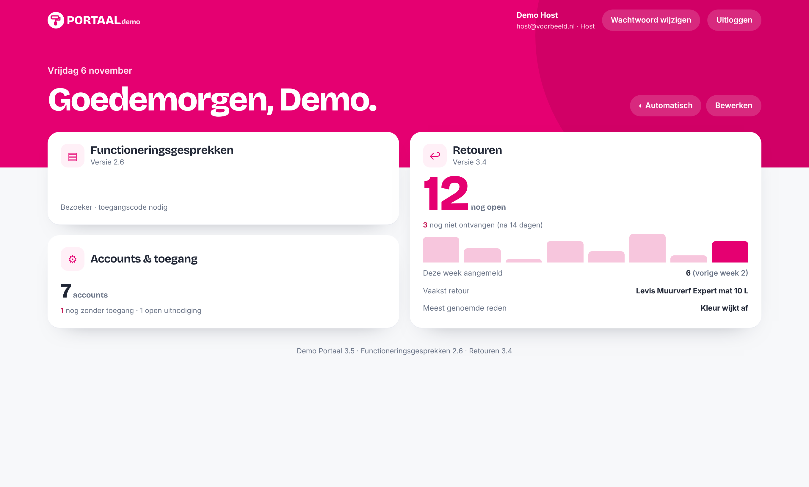
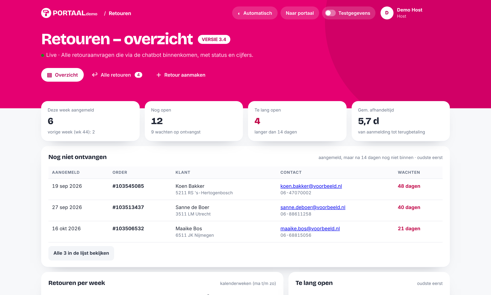
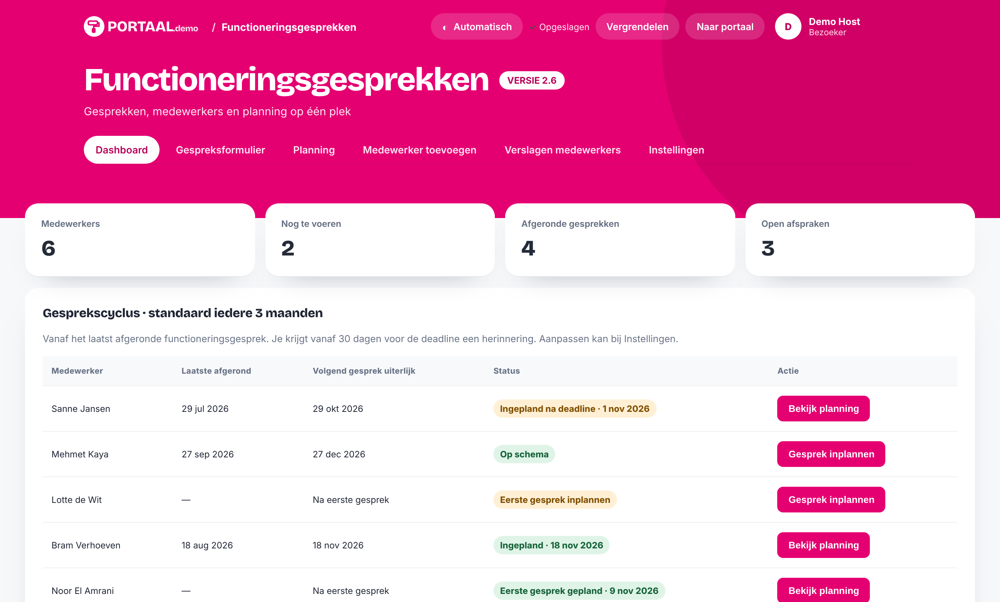
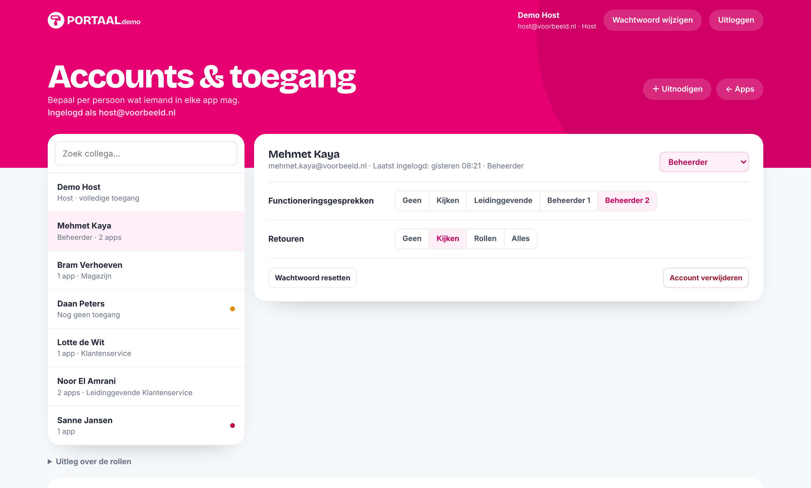
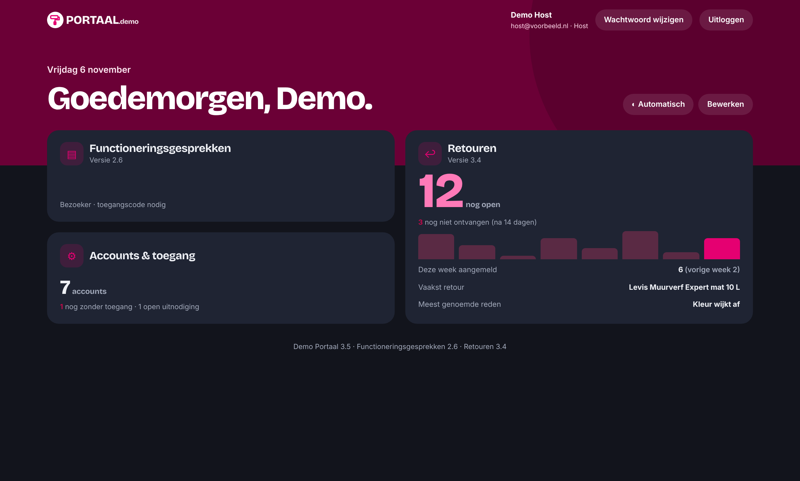

# Demo Portaal

Een intern portaal dat ik bouwde en dat in gebruik is bij een Nederlandse webshop: één plek met eigen apps voor collega's, met accounts, rollen en toegang per app. In deze demo zijn de naam, het logo en alle gegevens vervangen.
Dit is een **demoversie die volledig in je browser draait**, met verzonnen gegevens. Er is geen server, database of login nodig.

**Live demo:** https://teunvbeeck.github.io/portaal-demo/

## Bekijken

Open de live demo hierboven. Lokaal kan ook: download deze repo en open `index.html` in je browser.

Rechtsonder staat een demobalk. Met **Opnieuw beginnen** zet je alle gegevens terug naar de beginstand.

## Wat zit erin

| App | Wat het doet |
| --- | --- |
| **Startpagina** | Widgets met live cijfers per app (open retouren, retouren die te lang onderweg zijn, accounts zonder toegang). Indeling zelf aan te passen (slepen, grootte S/M/L, verbergen). Licht, donker of automatisch. |
| **Functioneringsgesprekken** | Gesprekken voeren en vastleggen: medewerkers, gespreksformulier, planning, afspraken, doelen volgen en verslagen als PDF. Rollen: Beheerder 1 en 2, Alleen kijken en Leidinggevende (ziet alleen de eigen afdeling, nooit het eigen dossier). De host komt alleen binnen met een toegangscode die een Beheerder 2 per mail krijgt. |
| **Retouren** | Alle retouraanvragen die via de klantenservice-chatbot binnenkomen: status bijhouden (aangemeld → ontvangen → gecontroleerd → terugbetaald), zoeken, cijfers per week en signalering van retouren die te lang openstaan. Rollen per afdeling: klantenservice, magazijn en financiën mogen elk alleen hun eigen stap zetten. |
| **Accounts & toegang** | Per persoon per app de toegang en rol kiezen, beheerders aanwijzen, uitnodigingen met vooraf gekozen toegang, geblokkeerde accounts vrijgeven, een logboek van alle wijzigingen en een testaccount om het portaal te bekijken als een gewone collega. |

| Retouren | Functioneringsgesprekken |
| --- | --- |
|  |  |

| Accounts & toegang | Donkere modus |
| --- | --- |
|  |  |

## Dingen om te proberen

- **Functioneringsgesprekken:** je bent hier "bezoeker". Vul `0000` in voor de testversie, of klik op **Code aanvragen**: in de demo verschijnt de code rechtsonder.
- **Retouren:** open een retour en zet de status op Ontvangen. De geschiedenis houdt bij wie wat deed.
- **Accounts & toegang:** geef iemand de rol Magazijn, maak een uitnodiging of klik op **Testaccount openen** om in een nieuw tabblad te zien wat een collega met die rechten ziet.

## Hoe het echte portaal werkt

De live versie draait op een eigen VPS (Ubuntu) in Docker, naast n8n en Traefik:

- **Backend:** [PocketBase](https://pocketbase.io) met eigen serverlogica (hooks) en database-migraties. De server controleert alle rechten; de browser krijgt alleen te zien wat iemand mag zien.
- **Accounts:** alleen werkmailadressen, uitnodigingen met vooraf gekozen toegang, extra inlogcode (2FA) voor host en beheerders, account 15 minuten geblokkeerd na 3 foute wachtwoorden en een logboek van alle wijzigingen.
- **Gelijktijdig werken:** optimistische versiecontrole, zodat collega's elkaars wijzigingen niet overschrijven. De Retouren-app werkt live bij (realtime).
- **Koppelingen via n8n:** de chatbot meldt nieuwe retouren aan via een webhook, orders worden opgezocht in Magento, retourformulieren worden als PDF gemaakt en gemaild, en elke nacht gaat er een versleutelde back-up (AES-256-GCM) naar Google Drive.
- **Versiebeheer per app:** elke app heeft een eigen versienummer en laat zien wanneer er een nieuwere versie online staat. Het portaal is te installeren als app.

## Hoe de demo werkt

De app-code in deze repo is dezelfde als in het echte portaal (alleen naam en logo zijn vervangen). Het enige verschil is
[`demo/mock-api.js`](demo/mock-api.js), dat als eerste wordt geladen. Dat script:

- onderschept alle verzoeken naar `/api/...` en beantwoordt ze in de browser, met dezelfde regels als de echte server
  (rechten, rollen, versiecontrole, toegangscode, statusgeschiedenis);
- slaat de verzonnen gegevens op in `localStorage`, zodat je wijzigingen bewaard blijven;
- logt je automatisch in als *Demo Host*.

Koppelingen met de buitenwereld (mail, Magento, Google Drive) doen in de demo niets. Alle namen, adressen, ordernummers en gesprekken zijn verzonnen.

---

Gemaakt door Teun van Beeck · [LinkedIn](https://www.linkedin.com/in/teun-van-beeck-0315832b8/)
