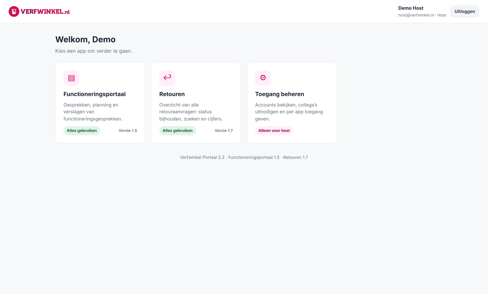
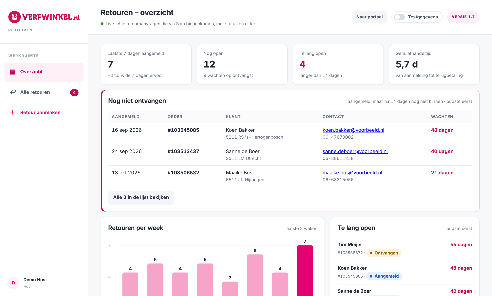
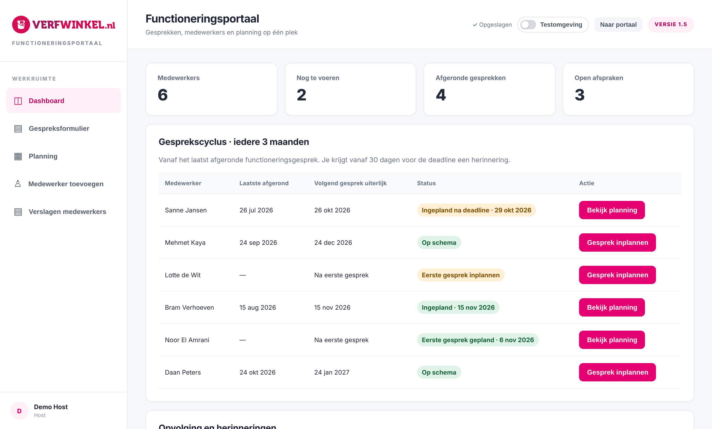
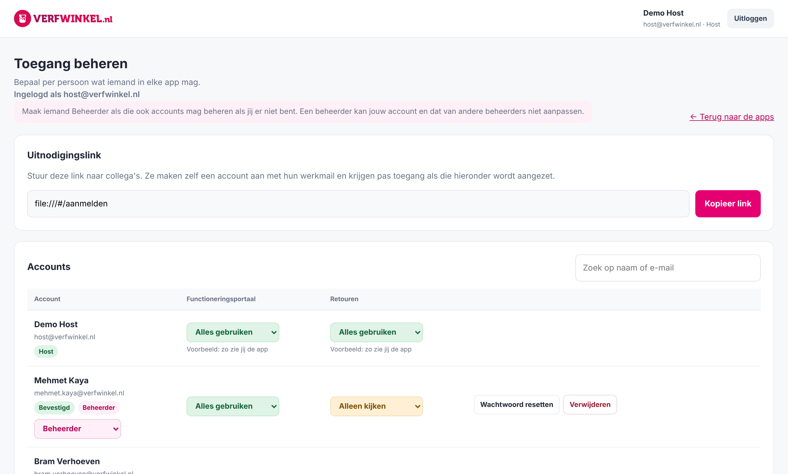

# Verfwinkel Portaal – demoversie

Een intern portaal dat ik bouwde voor [verfwinkel.nl](https://www.verfwinkel.nl): één plek met eigen apps voor collega's, met accounts, rollen en toegang per app.
Dit is een **demoversie die volledig in je browser draait**, met verzonnen gegevens. Er is geen server, database of login nodig.

## Bekijken

**Live demo:** https://teunvbeeck.github.io/verfwinkel-portaal-demo/

Of lokaal: download of clone deze repo en open `verfwinkel-portaal-demo/index.html` in je browser (dubbelklikken is genoeg).

Rechtsonder staat een demobalk. Met **Opnieuw beginnen** zet je alle gegevens terug naar de beginstand.

## Wat zit erin

| App | Wat het doet |
| --- | --- |
| **Functioneringsportaal** | Functioneringsgesprekken voeren en vastleggen: medewerkers, gespreksformulier, planning, afspraken en doelen volgen, verslagen als PDF. Inclusief een aparte testomgeving. |
| **Retouren** | Overzicht van alle retouraanvragen die via de klantenservice-chatbot binnenkomen: status bijhouden (aangemeld → ontvangen → gecontroleerd → terugbetaald), zoeken, cijfers per week en signalering van retouren die te lang openstaan. |
| **Toegang beheren** | Accounts beheren: per persoon per app *Geen toegang / Alleen kijken / Alles gebruiken*, beheerders aanwijzen, geblokkeerde accounts vrijgeven. |

| Retouren | Functioneringsportaal |
| --- | --- |
|  |  |

## Hoe het echte portaal werkt

De live versie draait op een eigen VPS (Ubuntu) in Docker, naast n8n en Traefik:

- **Backend:** [PocketBase](https://pocketbase.io) met eigen serverlogica (hooks) en database-migraties.
- **Accounts:** alleen werkmailadressen, bevestigen per mail, extra inlogcode (2FA) voor host en beheerders, account 15 minuten geblokkeerd na 3 foute wachtwoorden, opnieuw inloggen na 30 dagen.
- **Rollen:** host, beheerder en collega. Een beheerder kan het host-account en andere beheerders niet aanpassen.
- **Gelijktijdig werken:** optimistische versiecontrole, zodat collega's elkaars wijzigingen niet overschrijven. De Retouren-app werkt live bij (realtime).
- **Koppelingen via n8n:** de chatbot meldt nieuwe retouren aan via een webhook, mails lopen via n8n en elke nacht gaat er een versleutelde back-up (AES-256-GCM) naar Google Drive.
- **Versiebeheer per app:** elke app heeft een eigen versienummer en laat zien wanneer er een nieuwere versie online staat.

## Hoe de demo werkt

De app-code in `verfwinkel-portaal-demo/` (`index.html`, `functioneringsportaal/` en `retouren/`) is dezelfde als in het echte portaal. Het enige verschil is
[`demo/mock-api.js`](verfwinkel-portaal-demo/demo/mock-api.js), dat als eerste wordt geladen. Dat script:

- onderschept alle verzoeken naar `/api/...` en beantwoordt ze in de browser, met dezelfde regels als de echte server
  (versiecontrole, rechten, statusgeschiedenis);
- slaat de verzonnen gegevens op in `localStorage`, zodat je wijzigingen bewaard blijven;
- logt je automatisch in als het demo-account *Demo Host*.

Alle namen, adressen, ordernummers en gesprekken in deze demo zijn verzonnen.

---

Gemaakt door Teun van Beeck · [LinkedIn](https://www.linkedin.com/in/teun-van-beeck-0315832b8/)
